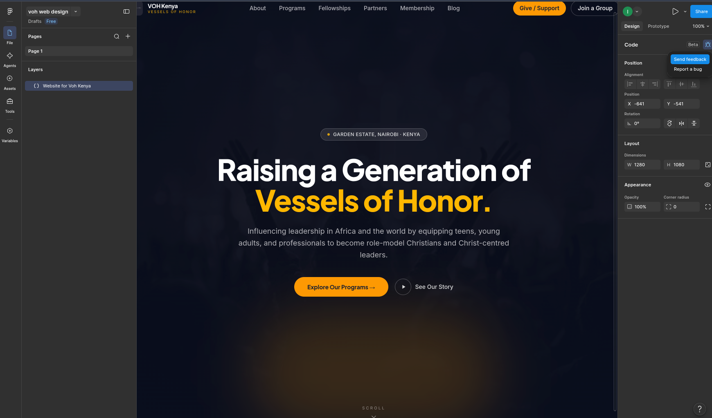
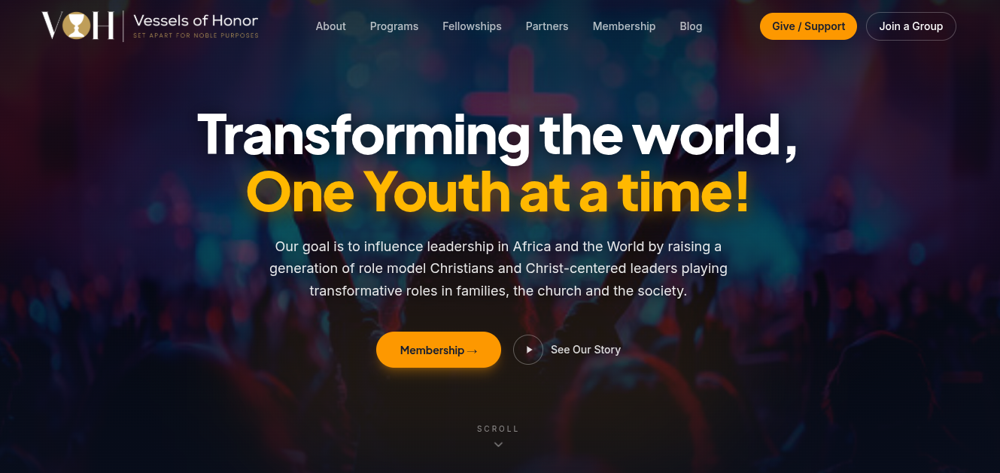
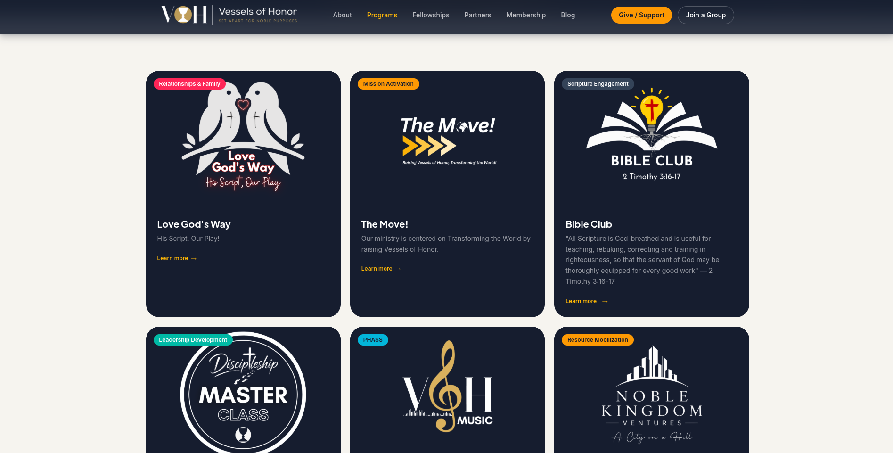
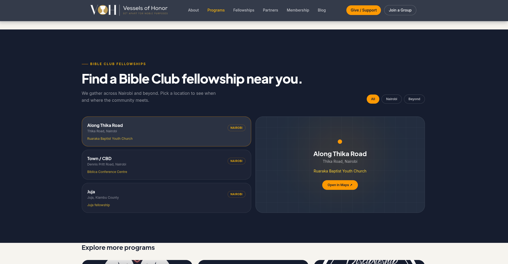
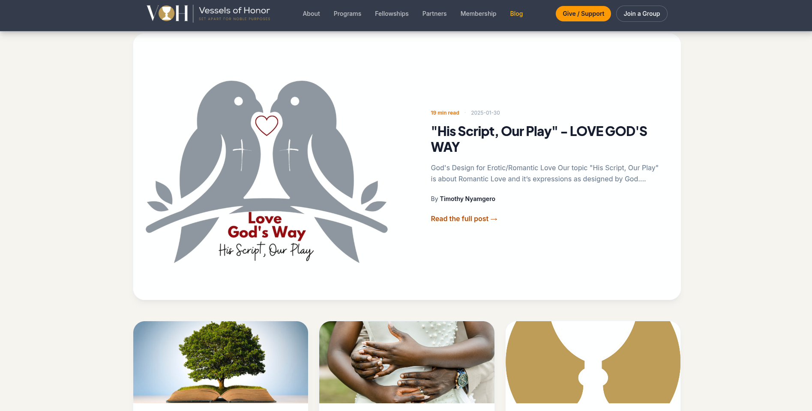
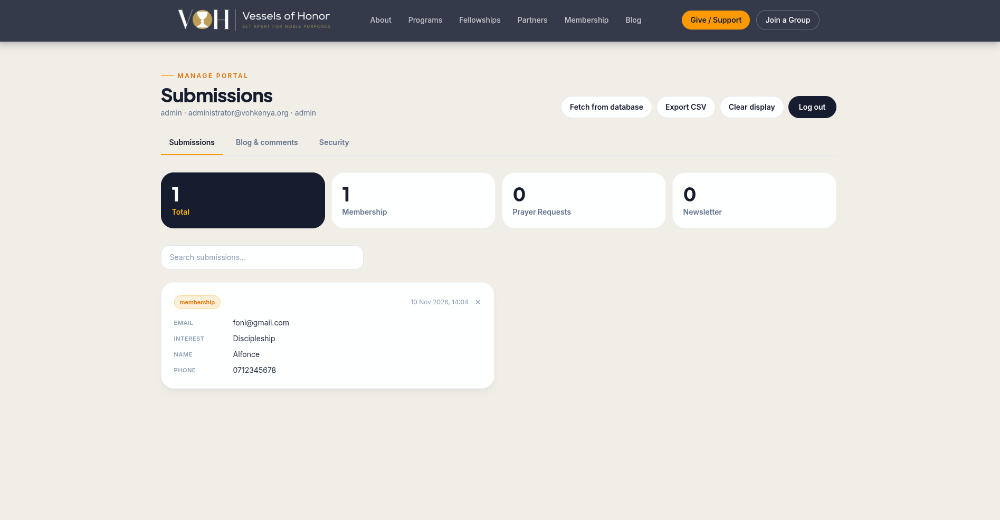
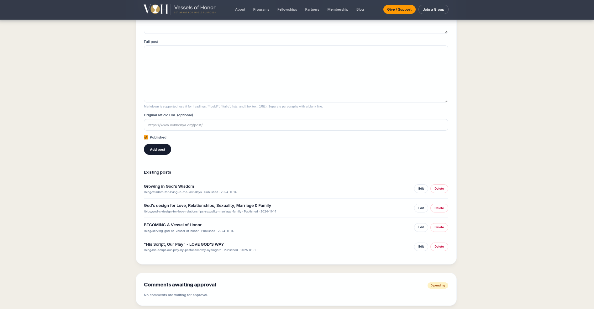

I collaborated with **[Jay Munene](https://github.com/JayMunene)** on the development of a new website for **Vessels of Honor (VOH) Kenya**. This was a two-person project that brought together UI/UX design, frontend and backend development, database integration, administration tools, and deployment.

The goal was to move beyond the organization's previous Wix website and build a more flexible platform for presenting its ministry, programs, community resources, and blog.

**Visit the website:** [www.vohkenya.org](https://www.vohkenya.org)

## Design and planning

We used **Figma** to plan and design the website before implementation. This gave us a shared reference for the page layouts, navigation, visual direction, and responsive experience.

<!-- Image placeholder: Add a screenshot of the Figma design file here. -->

*Interface planning and UI/UX design in Figma.*

## The public-facing website

The public website brings together key information about VOH Kenya and its activities. It includes sections covering:

- The organization, its mission, vision, and leadership.
- Teams and ministry activities.
- Missions and programs.
- Fellowships and partners.
- Membership and community engagement.
- Giving and prayer.
- Blog listings and individual articles.
- A digital altar for prayer-related content.

We developed the frontend using **React, TypeScript, Vite, and Tailwind CSS**, with responsive layouts and interactive components for desktop and mobile visitors.

<!-- Image placeholder: Add a screenshot of the public homepage here. -->

*The public-facing VOH Kenya homepage.*

<!-- Image placeholder: Add a screenshot of the programs, fellowships, or ministry pages here. -->

*Pages presenting the organization's programs.*

## Forms and content management

The website includes forms that allow visitors to connect and engage with VOH Kenya, including:

- Membership applications.
- Prayer requests.
- Newsletter subscriptions.

We connected the frontend to a **Flask and MySQL backend** for data handling, authentication, and blog services.

We also developed a management portal for authorized staff to:

- Create, edit, publish, and manage blog posts.
- Review and manage comments.
- Fetch and review visitor submissions.
- Manage user accounts according to their assigned roles.

<!-- Image placeholder: Add a screenshot of the blog listing or an individual article here. -->

*The blog experience for ministry articles, updates, and resources.*

<!-- Image placeholder: Add a screenshot of the administration submissions page here. -->

*The management portal's submissions interface.*

## Security and administration

The management portal uses role-based access control for staff workflows.

Access permissions are enforced by the backend, so restricted operations are not dependent only on frontend controls.

The portal also includes:

- Individual user accounts and logout.
- Inactivity-based session expiry.
- Optional multi-factor authentication for privileged access.
- Access restrictions for sensitive administrative functions.

<!-- Image placeholder: Add a screenshot of the blog management or user administration interface here. -->

*Content and administration within the management portal.*

## Deployment and domain configuration

The project also involved moving the website away from its previous Wix setup and configuring the new hosting arrangement.

The new application uses a split deployment:

- **Frontend:** Vercel.
- **Backend:** Host Pinnacle.
- **Domain management:** The domain was initially managed through Wix.

Configuring the domain was one of the more involved parts of the deployment. Because the frontend and backend were hosted separately, the DNS configuration needed to direct the relevant records to the correct services. Some records remained managed through Wix, while others were configured to connect the domain with Vercel and Host Pinnacle.

Coordinating these records required careful configuration and testing to ensure that the public website and backend services could work together under the same domain.

This part of the project provided practical experience with DNS records, domain management, and deploying an application across multiple hosting providers.

## Technologies and tools

| Area | Technologies / Platforms |
|---|---|
| UI/UX design | Figma |
| Frontend | React, TypeScript, Vite |
| Styling | Tailwind CSS |
| Backend | Python, Flask |
| Database | MySQL |
| Frontend hosting | Vercel |
| Backend hosting | Host Pinnacle |
| Version control | Git, GitHub |

## Collaboration

This was a **two-person project**. I worked alongside [Jay Munene](https://github.com/JayMunene), collaborating throughout the planning, design, development, testing, and implementation stages.

We shared the work involved in turning the project requirements and designs into a working website and management portal. The process called for regular coordination, technical problem-solving, and a shared commitment to seeing the project through.

I appreciate Jay's dedication, time, and effort throughout the project. His contribution was an important part of bringing the VOH Kenya website to life.

**Project collaborator:** [Jay Munene – GitHub](https://github.com/JayMunene)

## Project status

The new website is available at [www.vohkenya.org](https://www.vohkenya.org).

The frontend production build succeeds, the backend authentication tests pass, and the Flask API has been tested locally against the database. The remaining production-readiness tasks identified during development include confirming the hosting environment configuration, applying the database migration, and creating the initial IT Admin account.

## Reflections

This project gave us the opportunity to work across the different stages of a web application: planning and interface design, frontend and backend development, database integration, access control, and deployment.

It was also a reminder that launching a website involves more than building its pages. Integrating independently hosted services, configuring DNS, testing the application, and coordinating work as a team are all important parts of delivering a complete solution.
