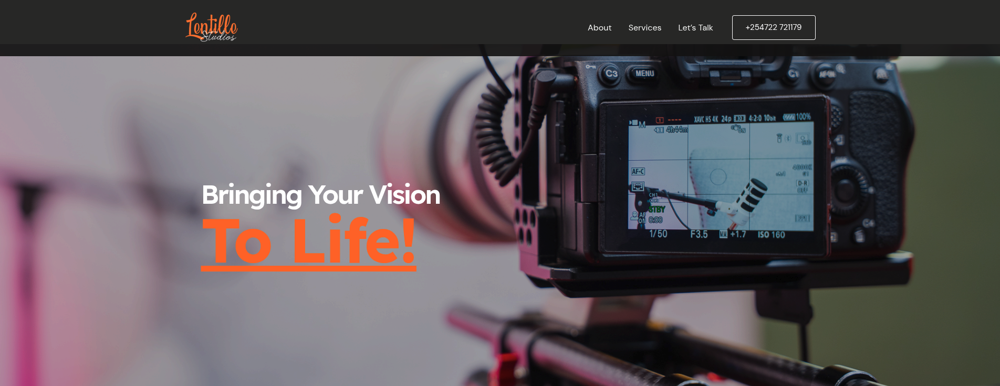
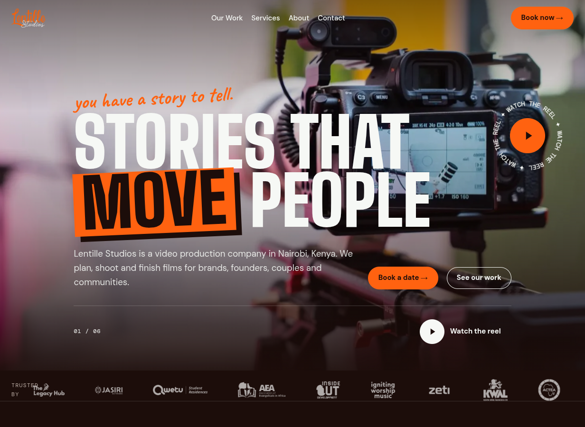
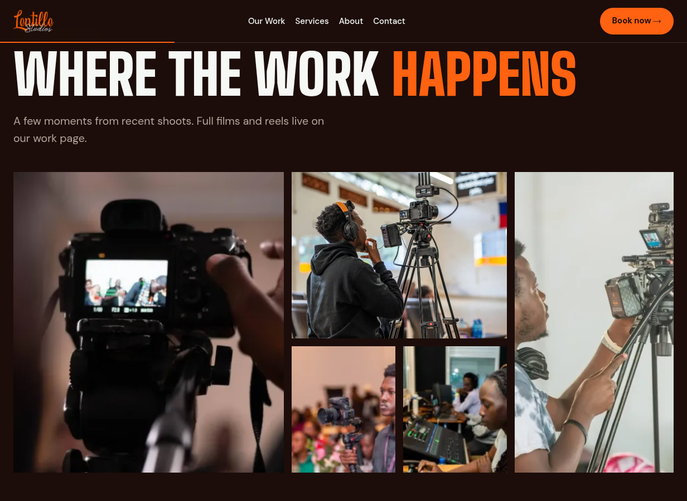
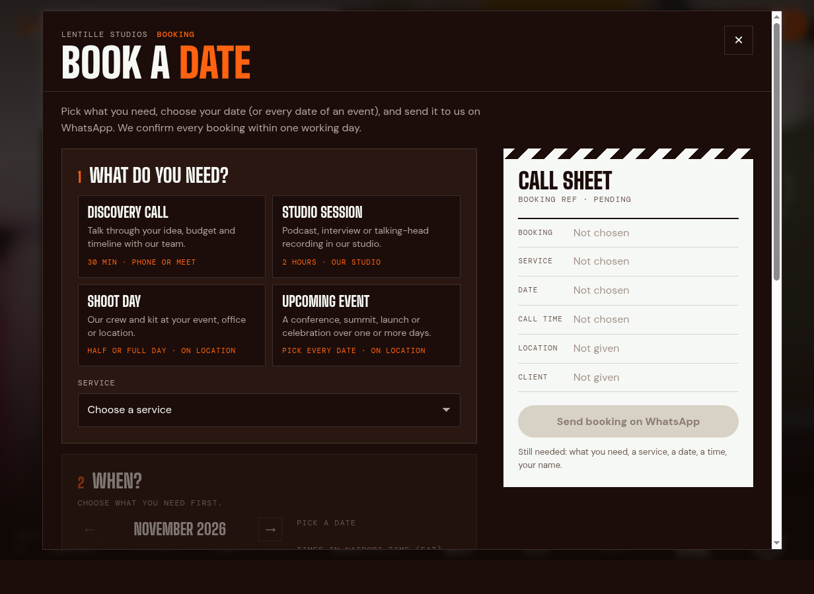
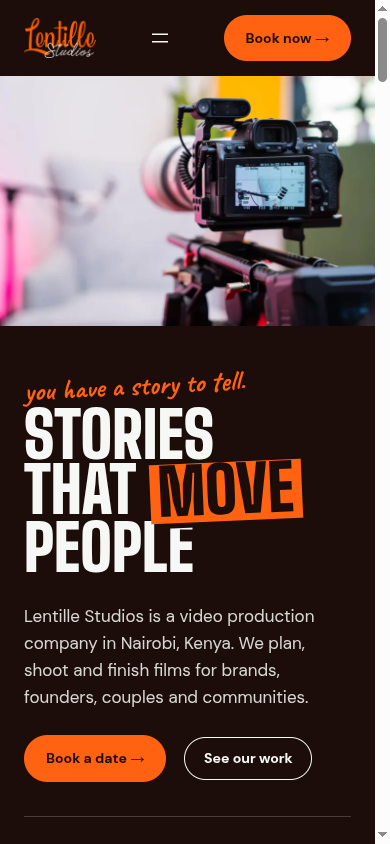

## Overview

[Lentille Studios](https://lentillestudios.com) is a Nairobi-based video production company producing documentaries, corporate films, branded content, video podcasts, weddings, and event coverage. Its previous website, built with Astra and Elementor, had become relatively heavy and difficult to maintain.

The objective was to create a website that reflected the studio's visual identity and creative work: bold imagery, the atmosphere of a film set, and a straightforward booking experience suited to how many Kenyan clients prefer to make enquiries—through WhatsApp.

The result is a custom WordPress block-theme website supported by seven integrated plugins, an optimized image pipeline, and a carefully managed launch that replaced the previous site while preserving its existing inbound URLs.

**Live website:** [lentillestudios.com](https://lentillestudios.com)  
**Launch:** November 2026

## Before and After

The April version used a simpler page layout and a narrower set of calls to action. The redesign centers the studio's work and adds clearer routes into the booking experience.

*The previous website, captured for the April 2026 project.*

*The refreshed homepage, captured at 100% browser zoom.*

## Screenshots of the New Website

*The “Our Work” section presents the studio’s portfolio in a visual, content-first format.*

*The booking call sheet gathers enquiry details before handing the request to WhatsApp.*

*The homepage adapts its navigation, hero image, and booking actions to a mobile viewport.*

## Collaboration and Credits

The project was delivered collaboratively:

- **Alfonce Mburu** — [GitHub](https://github.com/mburu-mwangi) · [Portfolio](https://mburu-mwangi.github.io): Web development.
- **Kelvin Mburu (Director Kev)** — Creative Director, Lentille Studios ([website](https://kelvin.lentillestudios.com/)): Creative direction, brand, photography, and content.

## Project Objectives and Discovery

The brief was to make the website feel like stepping onto a film set. Early discussions with Kelvin established several guiding principles:

- **Use authentic studio work.** The website uses the studio's own photography rather than stock images or video frame grabs.
- **Showcase the full range of services.** The site presents documentaries, corporate films, branded content, podcasts, weddings, events, and motorsport through dedicated areas of the Our Work section.
- **Make booking straightforward.** The “Book now” flow prepares a short call sheet and passes the enquiry to WhatsApp, reducing friction for prospective clients.
- **Make routine updates manageable.** Projects, podcasts, services, and team profiles can be maintained through dedicated dashboard interfaces without requiring a developer for every content update.

Interactive previews were used throughout the design process, progressing from the homepage concept to the wider website. This allowed layout and content decisions to be reviewed against real material before implementation in WordPress.

## Designing a Visual-First Showcase

The website was designed around the studio's photography and production work.

- **Viewfinder-inspired hero:** A crossfading slideshow presents finished work—including film sets, weddings, a WRC rally, and a summit stage—alongside the headline “Stories that move people”.
- **Filmstrip-style portfolio:** The Our Work section organizes content into categories such as Podcasts, Worship Sets, CSR, Corporate Events, Photoshoots, Weddings, Motorsport, Behind the Scenes, and Landscape. Filter controls help visitors explore the work; videos open in a pop-up player and photographs in a full-size viewer.
- **Team profiles:** Crew members have individual pop-ups featuring behind-the-scenes photography and short biographies. The Creative Director's profile links to his own website.
- **Responsive mobile experience:** The hero displays photographs without awkward cropping on smaller screens. The mobile navigation drops below the header, while phone and email links are configured for direct interaction.

One implementation issue involved the frosted-glass header. Its `backdrop-filter` created a containing block that trapped the fixed mobile menu inside the 76-pixel header area. Moving the blur effect to a `::before` layer resolved the issue while preserving the intended appearance.

## Media Optimization and Performance

For a video production company, image quality is central to the experience, but original camera files can add substantial page weight. The project therefore included a media optimization workflow.

- **Automated image processing:** The Photo Resizer plugin resizes uploaded images to a maximum longest side of 2048 pixels, applies automatic orientation correction, and converts images to WebP at quality 82. A background process also handles older uploads in batches.
- **Optimized image delivery:** Descriptive filenames and alt text support accessibility and search visibility. Responsive `srcset` attributes and lazy loading help prevent mobile devices from downloading unnecessarily large images.
- **Full-width layouts:** Root-padding-aware alignment allows selected sections and the hero to extend edge to edge while keeping text within comfortable reading margins.

The image-processing workflow reduced a representative 22 MB, 6000-pixel camera JPEG to approximately 580 KB. Across 146 images, the full photo set was reduced from 19.7 MB of original files to 11.2 MB in WebP format, before WordPress responsive image sizes further reduced the amount delivered on individual pages.

## Technology Stack

| Layer | Tools and implementation |
|---|---|
| CMS | WordPress 7.1; full-site-editing block theme using `theme.json`, templates, template parts, and block patterns |
| Front end | HTML5, CSS3 (custom properties, CSS Grid, and `:has()`), vanilla JavaScript |
| Custom functionality | Seven PHP plugins integrated into the theme: Booking, Team, Services, Podcasts, Projects, Photo Resizer, and Client Onboarding |
| Build process | Python scripts to generate the theme, block patterns, and plugin ZIP files from a shared content source |
| Media | WebP, Pillow, WordPress image editor, responsive `srcset`, and lazy loading |
| SEO | Custom metadata, Open Graph, schema.org JSON-LD (`ProfessionalService`, `WebSite`, `WebPage`), WordPress sitemap, and 301 redirects |
| Hosting and operations | HostPinnacle (cPanel and LiteSpeed), LiteSpeed Cache, JetBackup, and Imunify Security |
| Testing | WordPress Playground for local testing and viewport checks at 375, 1280, and 1920 pixels |
| Automation | Automated WordPress deployments with build validation |

## Launch and Migration

Replacing a live business website required a controlled migration process designed to protect existing content and search visibility.

1. **Back up the existing website:** Files and the database  were backed up using JetBackup before changes were made.
2. **Install and initialize the new site:** The theme setup process imported 67 photographs with alt text, created the Home, About Us, and Our Work pages, added a hidden client-onboarding page, and configured the homepage.
3. **Preserve existing URLs:** The previous `/about/`, `/services/`, `/contact/`, and `/portfolio/` URLs were redirected to their new destinations using 301 redirects.
4. **Clean up the installation:** Unused plugins and themes were removed. Obsolete pages were moved to the bin, and unused media files were deleted while retaining the site icon.
5. **Verify the live website:** Page titles, descriptions, structured data, sitemap, caching, and display across mobile and desktop were checked.

Automated deployments validate new theme builds before release.

## Post-Launch Updates

The website is structured to support ongoing content updates without requiring a rebuild. Following launch, a WRC Safari Rally Kenya 2021 project was added as a dedicated Our Work section and hero slide, using selected photographs.

The footer call to action was also updated to “Let's make it pop!”, and contact details were presented as one-tap call and email links. These updates were published directly to the live website.

## Key Takeaways

- **Content-first design improves implementation decisions.** Reviewing interactive previews with real content helped settle the visual direction before the WordPress build.
- **Purpose-built functionality can simplify content management.** Integrating dedicated plugins into the block theme provided editing interfaces for key content areas without relying on a heavy page builder.
- **Media optimization is part of the architecture.** Automated resizing, WebP conversion, and responsive delivery are particularly important for image-intensive business websites.
- **A controlled launch protects continuity.** Backups, URL redirects, cleanup, and staged verification helped make the migration predictable and reversible.
